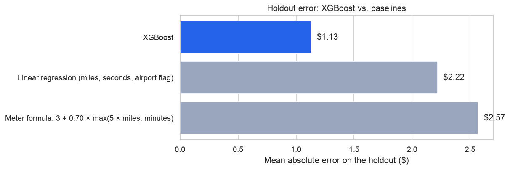
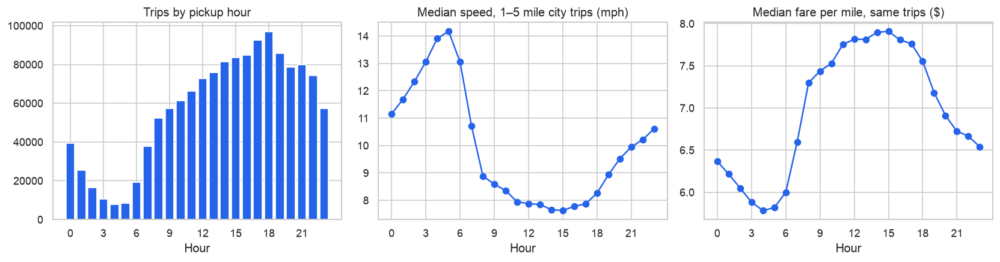
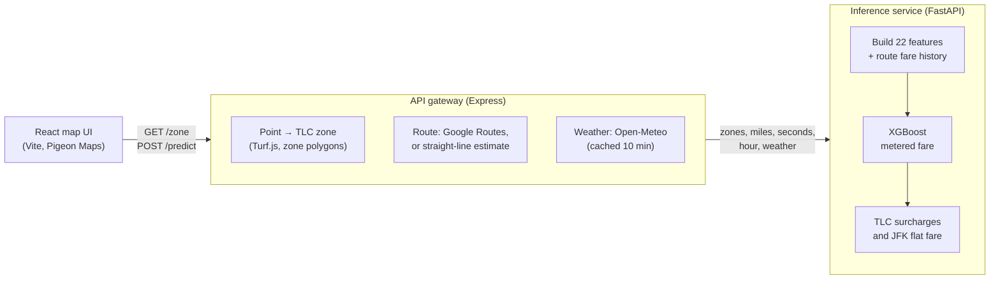

# NYC Taxi Fare Predictor

[](https://github.com/Jayendra70/NYC-Taxi-Fare-Forecasting-Analytics-System/actions/workflows/tests.yml)


Pick a pickup and a drop-off on a map of New York and get an itemized yellow-taxi fare. An XGBoost model trained on 9.75 million 2024 TLC trips predicts the metered fare. A gateway adds the route (Google Routes when configured) and live weather, and the official TLC surcharges are applied on top.

The interesting part is the evaluation, not the model choice: chronological validation, leakage-free route encoding, honest baselines, and a measurement of how much accuracy is lost when the model only has request-time estimates instead of the trip's recorded distance and duration.

## Results

Trained on January 1 to October 24, 2024 and tested on the remaining 1.95M trips (October 24 to December 31), using `notebooks/03_training.ipynb`.

| Method | MAE | RMSE | MAPE | R² |
|---|---|---|---|---|
| **XGBoost** | **$1.13** | **$3.29** | **6.3%** | **0.959** |
| Linear regression (miles, seconds, airport flag) | $2.22 | $4.72 | 12.7% | 0.916 |
| Meter formula: 3 + 0.70 × max(5 × miles, minutes) | $2.57 | $5.38 | 11.3% | 0.891 |
| XGBoost with request-time estimates instead of recorded inputs | $3.32 | $5.59 | 19.9% | 0.882 |

<p align="center"></p>

- **XGBoost halves the linear baseline's error.** 77% of holdout fares land within $1 of the prediction and 96% within $5. Errors concentrate in the under-1% of trips above $75.
- **The inputs are the bottleneck, not the model.** Swap each trip's recorded distance and duration for the training median of its route and time of day, and MAE triples to $3.32. A live request only has estimates, so improving the route estimate (Google's traffic-aware route rather than a lookup) matters more than tuning the model further.
- **Traffic is what the model learns beyond distance.** The meter bills by the minute below 12 mph. Median speed on 1–5 mile city trips falls from 14 mph at 5 AM to under 8 mph mid-afternoon, and the fare per mile rises from $5.80 to $7.90.

<p align="center"></p>

## How it works



1. The browser sends two coordinates. The gateway finds the TLC zone each one falls in using the official zone polygons, and rejects points outside the city.
2. It gets the driving distance, duration and tolls from the Google Routes API. Without an API key, or if the call fails, it estimates them from the straight-line distance.
3. It adds the current NYC hour and the weather, then calls the inference service.
4. The service builds the model's features, runs XGBoost for the metered fare, and adds the fixed TLC extras: MTA tax and improvement surcharge, rush-hour and overnight surcharges, congestion surcharges, airport fees, and the $70 Manhattan–JFK flat fare.

### Features

| Feature | Notes |
|---|---|
| `trip_miles`, `trip_time` | Distance and duration; 79% of the model's gain |
| `historical_route_fare` | Smoothed mean fare for the pickup→drop-off zone pair (37K routes). Out-of-fold during training so a trip never sees its own fare; routes with no history fall back to the meter formula |
| `implied_speed_mph` | Distance over duration, capped at 75; stands in for traffic |
| `PU_Borough_*`, `DO_Borough_*` | One-hot borough of pickup and drop-off |
| `is_airport_trip`, `request_hour`, `is_weekend` | |
| `temp`, `precip`, `snow` | Hourly Open-Meteo weather, same source and units in training and serving |

## Notebooks

| Notebook | What it covers |
|---|---|
| [`01_eda.ipynb`](notebooks/01_eda.ipynb) | Fares, distance, boroughs, time of day and weather on a 1.37M-trip sample |
| [`02_baselines_and_input_error.ipynb`](notebooks/02_baselines_and_input_error.ipynb) | January only: XGBoost against baselines, and how fast error grows when distance and duration are off by 10–25% |
| [`03_training.ipynb`](notebooks/03_training.ipynb) | Full-year training: hyperparameter search, holdout evaluation, error analysis, and export of `model.ubj` and `route_means.json` |

The shared loading and cleaning code is in [`notebooks/taxi_data.py`](notebooks/taxi_data.py). Trip data is downloaded from the TLC on first run (about 700 MB). The training notebook takes a few minutes and about 6 GB of RAM.

## Things that went wrong along the way

- **The weather join dropped 90% of the year.** An early daily weather table covered only 38 dates, and trips without weather were dropped, so the "full-year" model trained on 38 days. Hourly archive weather joined on the pickup hour fixed it.
- **The route feature leaked the target.** Each training trip's route mean included its own fare. Out-of-fold target encoding removed the leak, and an EDA notebook that scored the model on its own training trips was dropped.
- **Uber/Lyft fields in a yellow-taxi model.** Three features (`shared_match_flag`, `wav_match_flag`, `access_a_ride_flag`) come from the for-hire-vehicle dataset and were constant zero here. They were removed from the model and the API.
- **The meter fallback double-charged slow trips.** It added the full time charge on top of the full distance charge below 12 mph. The real meter charges one or the other: on late-January trips, 3 + 0.70 × max(5 × miles, minutes) misses by $2.10 against $4.64.
- **Meters left running.** Trips lasting up to 33 hours made the meter-formula baseline look far worse than it is (RMSE $21.50). Capping duration at four hours fixed the comparison.
- **The service and notebook disagreed on features.** The API hardcoded a column list that no longer matched the model, and XGBoost rejected every request. The service now reads the feature order from the saved model, and a test checks the committed model against the service.

## Running it locally

Requires Python 3.11+ and Node.js 20+. The trained model is in the repo, so no training is needed to run the app.

```bash
git clone https://github.com/Jayendra70/NYC-Taxi-Fare-Forecasting-Analytics-System.git
cd NYC-Taxi-Fare-Forecasting-Analytics-System

# 1. Inference service (port 8000)
cd service/ml-inference
python -m venv .venv && source .venv/bin/activate
pip install -r requirements-dev.txt
pytest
uvicorn main:app --port 8000

# 2. API gateway (port 5001), in a second terminal
cd service/api-gateway
cp .env.example .env        # optionally add a Google Routes API key
npm install && npm test
npm start

# 3. Frontend (port 5173), in a third terminal
cd service/web-frontend
npm install && npm run dev
```

Then open http://localhost:5173.

To retrain:

```bash
cd notebooks
python -m venv .venv && source .venv/bin/activate
pip install -r requirements.txt
jupyter nbconvert --to notebook --execute --inplace 03_training.ipynb
```

### Configuration

| Service | Variable | Default | Purpose |
|---|---|---|---|
| Gateway | `PORT` | `5001` | |
| Gateway | `PYTHON_MICROSERVICE_URL` | `http://127.0.0.1:8000` | Inference service URL |
| Gateway | `GOOGLE_MAPS_API_KEY` | unset | Enables traffic-aware routes and tolls; without it the route is estimated |
| Gateway, inference | `ALLOWED_ORIGINS` | `*` | Comma-separated CORS origins |
| Inference | `TAXI_MODEL_PATH` | `service/ml-inference/model.ubj` | Model file |
| Frontend | `VITE_API_URL` | `http://localhost:5001` | Gateway URL |

## Tests

CI runs on every push: the inference service (pytest and ruff), the gateway (`node:test` with supertest), and the frontend (ESLint and a production build).

- **Inference service:** the surcharge rules, the meter fallback, the full request path against a small stand-in model, and checks that the committed model and route table match what the service builds.
- **Gateway:** zone lookup, input validation, the route and weather fallbacks, and the request sent to the inference service, with external calls mocked.

## Project layout

```
notebooks/            EDA, baselines and training; plots/ holds the saved figures
service/
  ml-inference/       FastAPI service: features, model, TLC surcharges, tests
  api-gateway/        Express gateway: zone lookup, routing, weather, tests
  web-frontend/       React + Vite map UI
```

## Limitations

- The request-time evaluation uses route medians, not real Google Routes estimates, so the live error with a Google key is not measured.
- Surcharges follow the 2024–25 TLC rules. The congestion surcharge is applied to any trip touching Manhattan, while the real rule covers only trips below 96th Street.
- Tolls come from Google Routes and are added outside the model; without a key they are left out.

## License

[MIT](LICENSE). Trip data: [NYC Taxi & Limousine Commission](https://www.nyc.gov/site/tlc/about/tlc-trip-record-data.page). Weather: [Open-Meteo](https://open-meteo.com/).
